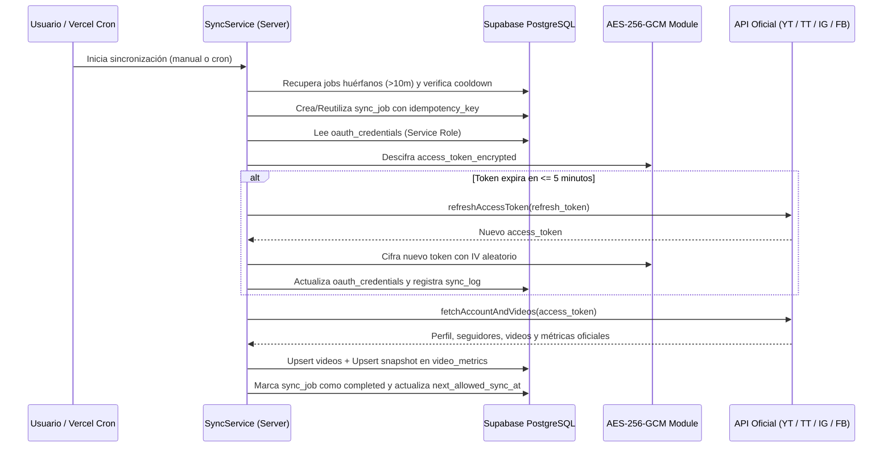

# Arquitectura del Sistema y Modelo de Datos

## 1. Decisiones Arquitectónicas Justificadas

1. **Next.js App Router + Server Components / Server Actions + Route Handlers**:
   - Las páginas del dashboard (`(dashboard)/dashboard`, `platforms/[platform]`, `videos`, `compare`, `connections`) se renderizan como **Server Components**, ejecutando las consultas a PostgreSQL directamente desde el servidor sin exponer lógica de negocio ni tokens al navegador.
   - Los flujos de redirección OAuth (`/api/oauth/[platform]/connect` y `/callback`) y el endpoint de sincronización programada (`/api/sync/cron`) se implementan como **Route Handlers** con control estricto de cookies `httpOnly` y cabeceras HTTP.
2. **Aislamiento Criptográfico de Credenciales OAuth (`public.oauth_credentials`)**:
   - A diferencia de arquitecturas vulnerables que guardan tokens en texto plano dentro de `social_accounts`, esta arquitectura separa los tokens en la tabla `public.oauth_credentials`.
   - En PostgreSQL, se ejecuta `REVOKE ALL ON TABLE public.oauth_credentials FROM public, anon, authenticated;` y se habilita `FORCE ROW LEVEL SECURITY` sin políticas para roles de cliente.
   - Además, antes de insertar en `oauth_credentials`, el backend cifra cada `access_token` y `refresh_token` con **AES-256-GCM** utilizando una clave de 256 bits (`OAUTH_ENCRYPTION_KEY`), un IV aleatorio de 12 bytes por operación y un Auth Tag de 16 bytes.
3. **Snapshots Históricos Idempotentes (`public.video_metrics`)**:
   - Para evitar sobrescribir el historial con los valores más recientes y al mismo tiempo garantizar idempotencia si una sincronización se ejecuta varias veces en la misma ventana horaria, `video_metrics` define una restricción única `UNIQUE (video_id, snapshot_hour)` donde `snapshot_hour = date_trunc('hour', captured_at)`.
   - Cada nuevo bucket horario o diario conserva un snapshot inmutable y calcula `views_delta`, `likes_delta`, `comments_delta` y `shares_delta` respecto al snapshot inmediatamente anterior.

---

## 2. Diagrama Entidad-Relación (PostgreSQL)

```mermaid
erDiagram
    PROFILES ||--o{ SOCIAL_ACCOUNTS : "posee"
    PROFILES ||--o{ OAUTH_CREDENTIALS : "titular (solo backend)"
    PROFILES ||--o{ PLATFORM_PERMISSIONS : "autoriza"
    PROFILES ||--o{ VIDEOS : "propietario"
    PROFILES ||--o{ VIDEO_METRICS : "propietario"
    PROFILES ||--o{ SYNC_JOBS : "ejecuta"
    PROFILES ||--o{ SYNC_LOGS : "audita"

    SOCIAL_ACCOUNTS ||--|| OAUTH_CREDENTIALS : "1:1 cifrado AES-256-GCM"
    SOCIAL_ACCOUNTS ||--o{ PLATFORM_PERMISSIONS : "scopes OAuth"
    SOCIAL_ACCOUNTS ||--o{ VIDEOS : "publica"
    SOCIAL_ACCOUNTS ||--o{ VIDEO_METRICS : "genera"
    SOCIAL_ACCOUNTS ||--o{ SYNC_JOBS : "sincroniza"

    VIDEOS ||--o{ VIDEO_METRICS : "historial de snapshots"
    SYNC_JOBS ||--o{ SYNC_LOGS : "registra eventos"

    PROFILES {
        uuid id PK
        text email UK
        text full_name
        text role
        text timezone
        timestamptz created_at
        timestamptz updated_at
    }

    SOCIAL_ACCOUNTS {
        uuid id PK
        uuid user_id FK
        text platform
        text external_account_id
        text account_name
        bigint followers_count
        integer posts_count
        text connection_status
        timestamptz last_synced_at
        timestamptz next_allowed_sync_at
    }

    OAUTH_CREDENTIALS {
        uuid id PK
        uuid social_account_id FK_UK
        uuid user_id FK
        text platform
        text access_token_encrypted
        text refresh_token_encrypted
        timestamptz expires_at
        smallint encryption_key_version
    }

    PLATFORM_PERMISSIONS {
        uuid id PK
        uuid social_account_id FK
        uuid user_id FK
        text platform
        text scope
        text status
    }

    VIDEOS {
        uuid id PK
        uuid social_account_id FK
        uuid user_id FK
        text platform
        text external_video_id
        text title
        text permalink
        timestamptz published_at
        bigint views_count
        bigint likes_count
        bigint comments_count
        bigint shares_count
        text[] unavailable_metrics
    }

    VIDEO_METRICS {
        uuid id PK
        uuid video_id FK
        uuid social_account_id FK
        uuid user_id FK
        date snapshot_date
        timestamptz snapshot_hour
        bigint views_count
        bigint views_delta
    }

    SYNC_JOBS {
        uuid id PK
        uuid user_id FK
        uuid social_account_id FK
        text trigger_source
        text status
        text idempotency_key UK
        integer videos_processed
    }

    SYNC_LOGS {
        uuid id PK
        uuid sync_job_id FK
        uuid user_id FK
        text level
        text event_type
        text message
        jsonb details
    }
```

---

## 3. Flujo de Sincronización y Renovación de Tokens


